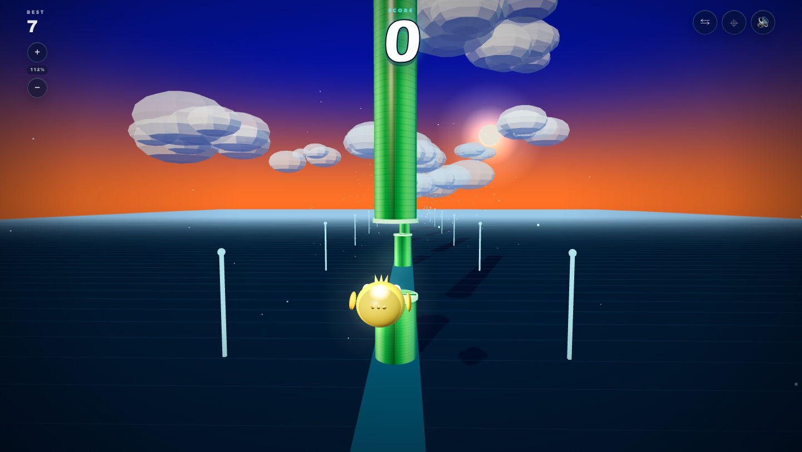

# Flappy Bird 3D

A complete, polished 3D Flappy Bird game in **one self-contained HTML file**. Built with Three.js, vanilla JavaScript, CSS, and the Web Audio API.



**Live demo:** <https://somphol.github.io/flappy-bird-3d/>

## Play

Open `index.html` in a modern browser, or serve the folder locally:

```sh
cd flappy-bird-3d
python3 -m http.server 8000
```

Then visit <http://localhost:8000>.

Three.js is loaded from jsDelivr, so the first load needs an internet connection.

## Controls

| Input | Action |
| --- | --- |
| `Space` / `ArrowUp` | Flap |
| Click / tap | Flap |
| Click / tap after a crash | Restart |
| Sound button (top right) | Mute / unmute |

## Features

- Third-person chase camera behind a glowing, low-poly bird
- Endless 3D pipe corridor with textured green cylinders, bright caps, and a soft gap glow
- Bounding-box collision against pipe geometry and the ground
- Flap impulse and gravity physics with bird tilt, wing animation, and a gentle camera follow
- Sunset gradient sky, drifting 3D cloud clusters, directional sunlight, soft shadows, fog, and speed particles
- Neon side pylons, ground grid, and a glowing runway for a strong sense of speed
- Large retro score HUD, `localStorage` high score, and a "New Best!" badge
- Game-over overlay with score, best, and a tap / press-space restart loop
- Synthesized Web Audio sound effects for flap, score, crash, and start
- Responsive desktop and mobile layout with safe-area support
- Single-file game logic and styling; only Three.js is external

## Tech

- [Three.js](https://threejs.org/) `0.169.0` via CDN import map
- HTML5 Canvas / WebGL
- CSS3
- Vanilla ES modules
- Web Audio API
- `localStorage`

## Build metadata

The agent build record is stored in [`state.json`](state.json), with a human-readable summary in [`STATE.md`](STATE.md).

- **Harness:** OpenCode `2.2.5`
- **Model:** DeepSeek V4.1 Flash (`opencode-go/deepseek-v4.1-flash`)
- **Session:** `ses_e6d14fab1ffe1Ks130scR0fjdU`
- **Project:** `~/Projects/flappy-bird-3d`

## Credits

Built with [OpenCode](https://opencode.ai) and **DeepSeek V4.1 Flash**. The game, 3D scene, HUD, audio, and build documentation were generated in a single agent session.

## License

MIT — see [`LICENSE`](LICENSE).
