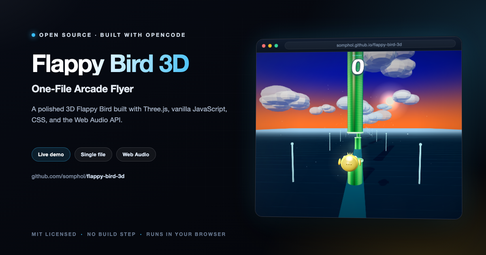

<div align="center">



# Flappy Bird 3D

**One-File Arcade Flyer**

A complete, polished 3D Flappy Bird built with Three.js, vanilla JavaScript, CSS, and the Web Audio API.

[](https://somphol.github.io/flappy-bird-3d/)
[](LICENSE)

**[Try it live →](https://somphol.github.io/flappy-bird-3d/)**

</div>

---

## Play

Open `index.html` in a modern browser, or serve the folder locally:

```sh
cd flappy-bird-3d
python3 -m http.server 8000
```

Then visit <http://localhost:8000>.

Three.js is loaded from jsDelivr, so the first load needs an internet connection.

## Controls

| Input | Action |
| --- | --- |
| `Space` | Flap |
| Click / tap | Flap |
| Drag | Orbit left / right and look up / down |
| `ArrowLeft` / `ArrowRight` / `ArrowUp` / `ArrowDown` | Orbit left / right and look up / down |
| `F` or the flip button | Flip between the left and right side views |
| Mouse wheel / `+` / `−` / zoom buttons | Zoom in and out |
| `R` or the crosshair button | Reset the view, including zoom |
| Click / tap after a crash | Restart |
| Sound button (top right) | Mute / unmute |

On touch screens, drag with one finger to orbit the camera and use the on-screen `+` / `−` buttons to zoom. Tap with a second finger to flap while holding the look drag. Drag all the way around to see the bird from the front.

## Features

- Third-person chase camera behind a glowing, low-poly bird
- Orbit camera: drag or use the arrow keys to swing around the bird, look up or down, and even see the front view; flip and reset controls included
- Zoomable view: mouse wheel, `+` / `−` keys, or on-screen zoom buttons
- Endless 3D pipe corridor with textured green cylinders, bright caps, and a soft gap glow
- Bounding-box collision against pipe geometry and the ground
- Flap impulse and gravity physics with bird tilt, wing animation, and a gentle camera follow
- Sunset gradient sky, drifting 3D cloud clusters, directional sunlight, soft shadows, fog, and speed particles
- Neon side pylons, ground grid, and a glowing runway for a strong sense of speed
- Large retro score HUD, `localStorage` high score, and a "New Best!" badge
- Game-over overlay with score, best, and a tap / press-space restart loop
- Synthesized Web Audio sound effects for flap, score, crash, and start
- Responsive desktop and mobile layout with safe-area support
- Single-file game logic and styling; only Three.js is external

## Tech

- [Three.js](https://threejs.org/) `0.169.0` via CDN import map
- HTML5 Canvas / WebGL
- CSS3
- Vanilla ES modules
- Web Audio API
- `localStorage`

## Build metadata

The agent build record is stored in [`state.json`](state.json), with a human-readable summary in [`STATE.md`](STATE.md).

- **Harness:** OpenCode `2.2.5`
- **Model:** DeepSeek V4.1 Flash (`opencode-go/deepseek-v4.1-flash`)
- **Session:** `ses_e6d14fab1ffe1Ks130scR0fjdU`
- **Project:** `~/Projects/flappy-bird-3d`

## Credits

Built with [OpenCode](https://opencode.ai) and **DeepSeek V4.1 Flash**. The game, 3D scene, HUD, audio, and build documentation were generated in a single agent session.

## Contributing

Contributions are welcome — bug reports, feature ideas, accessibility improvements, and
documentation fixes alike. Please read [CONTRIBUTING.md](CONTRIBUTING.md) and the
[Code of Conduct](CODE_OF_CONDUCT.md) before opening a pull request.

- **Found a bug?** [Open a bug report](https://github.com/somphol/flappy-bird-3d/issues/new?template=bug_report.yml)
- **Have an idea?** [Request a feature](https://github.com/somphol/flappy-bird-3d/issues/new?template=feature_request.yml)
- **Found a vulnerability?** Please follow [SECURITY.md](SECURITY.md) and report it privately.

## Documentation

| Document | Purpose |
| --- | --- |
| [AGENTS.md](AGENTS.md) | Handoff for the next maintainer or AI agent |
| [docs/REPRODUCTION.md](docs/REPRODUCTION.md) | Rebuild and verification book |
| [docs/ARCHITECTURE.md](docs/ARCHITECTURE.md) | Module map, physics, camera and algorithms |
| [docs/TESTING.md](docs/TESTING.md) | Verified matrix, manual cases, and gaps |
| [docs/DEPLOYMENT.md](docs/DEPLOYMENT.md) | GitHub Pages operations and rollback |
| [skills/flappy-bird-3d/SKILL.md](skills/flappy-bird-3d/SKILL.md) | Reusable build skill and template |
| [README.md](README.md) | Overview, setup, controls, and architecture |
| [CHANGELOG.md](CHANGELOG.md) | Notable changes and release history |
| [CONTRIBUTING.md](CONTRIBUTING.md) | Local workflow, constraints, and pull request checks |
| [SECURITY.md](SECURITY.md) | Supported versions and private vulnerability reporting |
| [STATE.md](STATE.md) | Build timing, verification record, and token usage |
| [LICENSE](LICENSE) | MIT licence |

## License

MIT — see [`LICENSE`](LICENSE).
